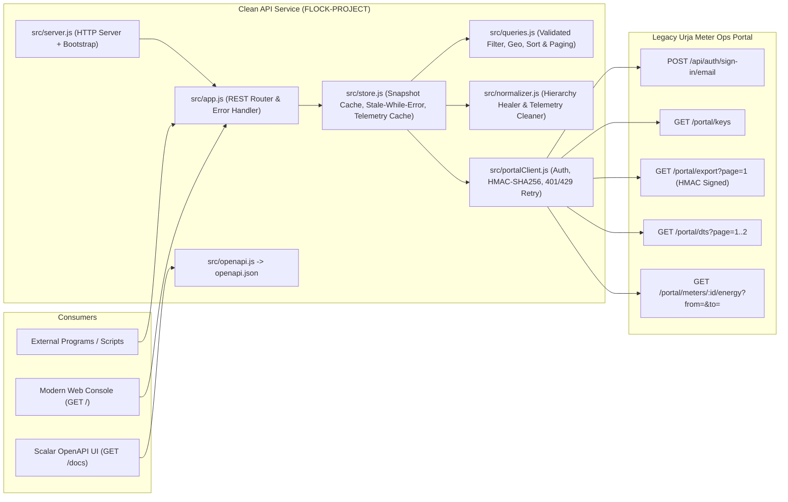

# Urja Meter Ops — Clean API Service & Operations Console

I built a clean, normalized, and resilient REST API service (plus an interactive web console) in front of the legacy **Urja Meter Ops** utility portal (`https://urja-ops.flockenergy.tech`).

> ### 🚀 Deployed
> **Live demo: https://urja-meter-ops-alpha.vercel.app** — the web console, plus the API at [`/api/v1/meters`](https://urja-meter-ops-alpha.vercel.app/api/v1/meters), interactive docs at [`/docs`](https://urja-meter-ops-alpha.vercel.app/docs) and the spec at [`/openapi.json`](https://urja-meter-ops-alpha.vercel.app/openapi.json).
> Hosted on Vercel as a serverless function (see [Deploy](#deploy-vercel)). The first request after a quiet spell takes about a second longer while the data is fetched from the portal.
> Source: https://github.com/Trishgupta44/urja-meter-ops-api

---

## Quick Links to Key Deliverables

| Deliverable | File / Route | Description |
| :--- | :--- | :--- |
| **Live Deployment** | [urja-meter-ops-alpha.vercel.app](https://urja-meter-ops-alpha.vercel.app) | The deployed web console and API (Vercel). Nothing to install to evaluate it. |
| **Portal Reverse-Engineering Report** | [`PROTOCOL.md`](./PROTOCOL.md) | Complete write-up of how the portal works under the hood: Better Auth session flow, HMAC-SHA256 signing for `/portal/export`, hidden `?from=&to=` telemetry parameters, and all **10 protocol/data quirks** discovered. |
| **OpenAPI 3.1.0 Specification** | [`openapi.json`](./openapi.json) (`GET /openapi.json`) | Full OpenAPI 3.1.0 spec for the clean API service. Also served interactively via Scalar at `http://localhost:3000/docs`. |
| **Engineering Reflection** | [`REFLECTION.md`](./REFLECTION.md) (and [below](#reflection)) | Answers to the 5 reflection questions (assumptions, hardest problem, mistakes made, next-day improvements, self-critique). |
| **API Source Code** | [`src/`](./src) | Zero-dependency Node.js (`>=18`) ES module service with automated healing, local indexing, Haversine geospatial search, and modern web UI. |
| **Automated Test Suite** | [`test/`](./test) | 90 tests (about 99% line coverage): query validation, cache/stale-data behaviour with a fake clock, portal-client resilience, normalization, every HTTP route, and a check that the router and `openapi.json` agree. |

---

## 1. What I Found Out (Summary of Portal Discovery)

By inspecting the portal's SvelteKit client bundles (`/_app/immutable/nodes/2..7.js`) and runtime network traffic, I worked out how the portal actually works (documented in full detail in [`PROTOCOL.md`](./PROTOCOL.md)):

1. **Hidden Bulk Export with HMAC-SHA256 Signing (`GET /portal/export`)**:
   - While `/meters` paginates 20 rows at a time via `GET /portal/meters/search?q=&page=1..21` (and omits `installType`, `build`, `hierarchy`, and `geo`), the `/transformers` bundle contains an **"Export all meters"** handler that fetches `signingSecret` from `GET /portal/keys`, signs `GET\n/portal/export\npage=1\n<unix_timestamp>` with **HMAC-SHA256**, and calls `GET /portal/export?page=1` with `x-timestamp` and `x-signature` headers.
   - That single call returns **all 403 meters at once**, complete with `installType`, `build` (`legacy` vs `v2`), full 7-level `hierarchy`, and numeric `geo` (`{ lat, lng }`).
2. **Dual Meter Nameplate Schema (`legacy` vs. `v2`)**:
   - 238 meters have `build: "legacy"` (SSR detail is an array of `{ parameterName, parameterValue }`), while 165 meters have `build: "v2"` (SSR detail is a double-encoded JSON string inside `classData: "{\"installed_meter\":{...}}"`).
3. **Hidden 30-Day Telemetry Window (`?from=YYYY-MM-DD&to=YYYY-MM-DD`) & Mixed Resolution**:
   - Calling `GET /portal/meters/:id/energy` without parameters only returns the default 7-day window (`23/06/2026` to `30/06/2026`). Passing `?from=2026-06-01&to=2026-06-30` unlocks the full 30-day month of June 2026.
   - Meters `J100000`–`J100039` (40 meters) report **30-minute intervals** (`337` readings in 7d / `1,440` in 30d), whereas `J100040`–`J100402` (363 meters) report **daily `00:00` intervals** (`8` readings in 7d / `30` in 30d).
4. **Messy & Inconsistent Data the Service Heals Automatically**:
   - **22 Missing Hierarchy Codes/Names**: 14 meters have `code: ""` (with valid `name`) and 8 meters have `name: ""` (with valid `code`) at the `circle`, `substation`, or `feeder` level.
   - **Conflicting Transformer Name on `DT-007` (`J100400`–`J100402`)**: The last 3 meters name `DT-007` `"Old Malviya Nagar Xfmr"` and use serial prefix `GN` (`GN31592`, `GN61501`, `GN11062`), whereas `/portal/dts` and the other 10 meters on `DT-007` name it `"Sanganer DT 7"`.
   - **Corrupted Duplicate Telemetry Rows**: 5 meters (`J100089`, `J100134`, `J100195`, `J100211`, `J100330`) have a trailing duplicate `30/06/2026 00:00` reading where `kwh: ""` and `voltR: ""`.
   - **URL-Unsafe Serial Numbers (`L&`)**: 77 meters have serial numbers containing a literal `&` (e.g. `L&84997`), which breaks unencoded query strings.

---

## 2. Architecture & How Everything Connects in the Repo



### File-by-File Repository Map

- **[`src/config.js`](./src/config.js)**: Loads `.env` (if present) and exports typed configuration defaults (`PORT`, `PORTAL_BASE_URL`, `PORTAL_EMAIL`, `PORTAL_PASSWORD`, cache TTLs, timeout, retry limits, and the stale-data cooldown / forced-refresh throttle / telemetry-cache cap — see [`.env.example`](./.env.example)).
- **[`src/portalClient.js`](./src/portalClient.js)**: Encapsulates all communication with `https://urja-ops.flockenergy.tech`.
  - Handles **Better Auth** login (`POST /api/auth/sign-in/email` with fallback to `POST /login`), extracts the `__Secure-better-auth.session_token` cookie (`Max-Age=3600`), and deduplicates concurrent logins via a single-flight promise.
  - Implements `signPortalRequest()` (`HMAC-SHA256` over `GET\n/portal/export\npage=1\n<timestamp>`) using `signingSecret` from `GET /portal/keys`.
  - Automatically re-authenticates on `401` and retries `429 Too Many Requests` / `5xx` with exponential backoff + jitter.
- **[`src/normalizer.js`](./src/normalizer.js)**: Pure data transformation and reconciliation functions (easy to unit-test in isolation).
  - `reconcileDataset(rawMeters, rawTransformers)`: Builds canonical code↔name maps across all 7 hierarchy levels, heals the 22 missing codes/names, reconciles the `DT-007` name conflict (`"Old Malviya Nagar Xfmr"` → `"Sanganer DT 7"`), flags the 323 serial-prefix/make mismatches, reconstructs the 7-level hierarchy tree + 40 DT paths, and catalogs all anomalies.
  - `normalizeEnergyReadings(meterId, rawReadings)`: Parses `DD/MM/YYYY HH:mm` into ISO-8601 (`+05:30`), strips corrupted duplicate rows (like `J100089`), converts strings to numbers, and computes `deltaKwh`, `powerFactor`, `granularity` (`30m` vs `daily`), and summary statistics.
  - `haversineDistanceKm(lat1, lng1, lat2, lng2)`: Great-circle distance calculation for geospatial radius queries.
- **[`src/queries.js`](./src/queries.js)**: Pure query layer. Parses and validates every query parameter, then filters, geo-searches, sorts, paginates and facets the in-memory meters. No I/O, so it is tested exhaustively on its own.
- **[`src/store.js`](./src/store.js)**: `UrjaDataStore` owns freshness, not query logic.
  - Bootstraps all 403 meters and 40 DTs in **3 HTTP requests** and shares one in-flight sync between concurrent callers.
  - **Stale-while-error**: if a refresh fails, the last good snapshot is served with `staleFallback: true` and further refreshes pause for a cooldown, so an outage does not become a request storm.
  - Forced refreshes (`?refresh=true`, `POST /api/v1/sync`) are throttled and surface failures instead of hiding them.
  - Per-meter telemetry is cached per `(meter, window)` in a bounded cache, with identical concurrent requests sharing one portal call.
- **[`src/errors.js`](./src/errors.js)**: `ApiError` (status + stable `code` + optional `details`) for conditions I report on purpose.
- **[`src/app.js`](./src/app.js)**: A small route table (exported, so tests can compare it with the OpenAPI document) mapping `/api/v1/*`, `/openapi.json`, `/docs` and `/` to the store, with `X-Cache` headers, `405` + `Allow`, and one place that maps errors to HTTP (see [Errors](#errors)).
- **[`src/openapi.js`](./src/openapi.js)** & **[`openapi.json`](./openapi.json)**: OpenAPI 3.1.0 specification generator (`npm run generate:openapi` writes `openapi.json`).
- **[`src/public/index.html`](./src/public/index.html)**: The web console at `http://localhost:3000/` — a single file with no build step. Plain-language labels and four views: *Meters* (search, filters, "near a place"), *Map* (every meter plotted by status, with transformer highlighting), *Network* (collapsible Zone → … → Transformer tree) and *Data quality* (every problem found and how it was handled). Opening a meter shows energy used per day and the daily voltage range against the normal band, with a one-line summary. Every value is HTML-escaped by default through a tagged template, there are no inline event handlers, and API errors are shown rather than swallowed.
- **[`test/`](./test)**: `node:test` suites — `queries`, `store` (fake clock), `portalClient`, `normalizer`, and `api` (real HTTP server against a mock portal) — sharing the fixtures in `test/fixtures.js`.

---

## 3. How to Install, Configure & Run

### Prerequisites
- **Node.js `>= 18.0.0`** (uses built-in `fetch`, `node:http`, `node:crypto`, and `node:test` — **zero external `npm` dependencies required**).

### Start the Server
```bash
git clone https://github.com/Trishgupta44/urja-meter-ops-api.git
cd urja-meter-ops-api
npm start
```
There is no `npm install` step: the service has no dependencies.
*(Optional)* Copy `.env.example` to `.env` to customize `PORT` (default `3000`), portal credentials, or cache TTLs.

Once started, open:
- **Modern Web Console**: `http://localhost:3000/`
- **Interactive OpenAPI Docs (Scalar)**: `http://localhost:3000/docs`
- **Raw OpenAPI 3.1 Spec**: `http://localhost:3000/openapi.json`

### Deploy (Vercel)
This project is deployed at **https://urja-meter-ops-alpha.vercel.app**. The repo includes a serverless entry point ([`api/index.js`](./api/index.js)) and [`vercel.json`](./vercel.json), so it deploys as-is:
```bash
npx vercel deploy --prod
```
- `vercel.json` sets `"framework": null` on purpose: Vercel's auto-detection otherwise mistakes `src/app.js` for an Express-style server entry and crashes.
- The in-memory index lives per warm function instance, so the first request after idle includes a portal sync (about a second); later requests are served from memory. This is the same trade-off described under *Scale Analysis* below, and a shared cache (Redis/SQLite) would remove it.
- Portal credentials default to the ones supplied with the assignment. For anything real, set `PORTAL_EMAIL` and `PORTAL_PASSWORD` as project environment variables instead.

### Run the Automated Tests
```bash
npm test
```
Add `--experimental-test-coverage` (`node --test --experimental-test-coverage`) for a coverage report. If you change the API, run `npm run generate:openapi`; a test fails when the committed `openapi.json` is out of date.

---

## 4. API Endpoints & Sample Requests

| Method & Path | Description |
| :--- | :--- |
| `GET /api/v1/health` | Service uptime, cache freshness, and upstream portal connection stats. |
| `GET /api/v1/meters` | Search, filter (maker, phase, status, install type, build, granularity, 7 hierarchy levels, data-quality flags), geo-search, sort and paginate meters. |
| `GET /api/v1/meters/:meterId` | Full normalized meter record, parent transformer, healed hierarchy, and data quality audit. |
| `GET /api/v1/meters/:meterId/consumption` | Normalized interval telemetry (`?from=YYYY-MM-DD&to=YYYY-MM-DD`), summary stats, and anomaly filtering. |
| `GET /api/v1/transformers` | List/filter all 40 Distribution Transformers (`DT-001`–`DT-040`) with attached meter breakdowns. |
| `GET /api/v1/transformers/:code` | Single transformer details and all connected meters. |
| `GET /api/v1/hierarchy` | Reconstructed 7-level network hierarchy (Zone tree, 40 DT paths, and Modulo DAG analysis). |
| `GET /api/v1/anomalies` | Full audit report of all structural and telemetry anomalies discovered and healed. |
| `POST /api/v1/sync` | Force an immediate bulk re-sync with the upstream portal. |

### Query behaviour
- **Strict inputs.** Unknown query parameters are rejected, so a typo such as `lat=` (instead of `nearLat=`) fails loudly instead of silently returning every meter. Enum filters (`status`, `make`, `phase`, `installType`, `build`, `granularity`) accept comma-separated, case-insensitive values and are checked against the values that actually occur in the data.
- **Paging.** `limit` defaults to 20 (max 500 for meters, 100 for transformers; larger values are clamped). A `page` past the end returns the last page.
- **Provenance.** Every response has `meta.cacheHit`, `meta.staleFallback` and `meta.lastSyncedAt`, mirrored in the `X-Cache` header (`HIT`, `MISS` or `STALE`).

### Errors
All errors share one envelope: `{ "error": { "code", "message", "status", "details"? } }`.

| Status | `code` | When |
| :--- | :--- | :--- |
| 400 | `bad_request` | Unknown parameter, malformed value, or a value outside the allowed set. `details.allowed` / `details.supported` say what would have worked. |
| 404 | `not_found` | Unknown meter, transformer or route. |
| 405 | `method_not_allowed` | Known path, wrong method (with an `Allow` header). |
| 429 | `upstream_rate_limited` | The portal is rate limiting the service and retries were exhausted. |
| 502 | `upstream_error`, `upstream_unauthorized` | The portal request failed. |
| 504 | `upstream_timeout` | The portal did not respond in time. |
| 500 | `internal_error` | A bug in the service. The message is generic; details are logged, not returned. |

Reads keep working through a portal outage as long as a snapshot exists (flagged `STALE`; `/api/v1/health` reports `degraded`). `POST /api/v1/sync` is the exception: it reports the failure.

### Sample Request 1: Multi-Attribute + Geospatial Radius Search
Find all **Faulty** meters within **3.5 km** of Malviya Nagar (`26.8549, 75.8243`), sorted by distance:
```bash
curl -s "http://localhost:3000/api/v1/meters?status=Faulty&nearLat=26.8549&nearLng=75.8243&radiusKm=3.5"
```

### Sample Request 2: Search a Serial Containing a Literal `&` (`L&84997`)
```bash
curl -s "http://localhost:3000/api/v1/meters?q=L%2684997"
```

### Sample Request 3: Fetch Full 30-Day Consumption Telemetry (With Corrupted Row Stripping)
```bash
curl -s "http://localhost:3000/api/v1/meters/J100089/consumption?from=2026-06-01&to=2026-06-30"
```
Sample response excerpt:
```json
{
  "data": {
    "meterId": "J100089",
    "granularity": "daily",
    "count": 30,
    "rawCount": 31,
    "summary": {
      "startTimestamp": "2026-06-01T00:00:00+05:30",
      "endTimestamp": "2026-06-30T00:00:00+05:30",
      "startCumulativeKwh": 12510.64,
      "endCumulativeKwh": 12732.34,
      "totalConsumptionKwh": 221.7,
      "totalConsumptionKvah": 239.43,
      "minVoltageR": 221,
      "maxVoltageR": 239,
      "avgVoltageR": 231
    },
    "anomalies": [
      {
        "meterId": "J100089",
        "index": 30,
        "type": "corrupted_duplicate_reading",
        "raw": { "timestamp": "30/06/2026 00:00", "kwh": "", "kvah": "13750.93", "voltR": "" },
        "resolution": "Filtered out corrupted/duplicate reading row"
      }
    ]
  }
}
```

---

## 5. Design Decisions, Trade-offs & Scale Notes

### Why Bootstrap via `/portal/export` Instead of Proxying `/portal/meters/search`?
- **Portal Search Limitations**: `/portal/meters/search` only searches `meterId` and `serialNo`, returns 20 items per page, and omits `installType`, `build`, `hierarchy`, and `geo`. Answering a query like *"find all three-phase Faulty Genus meters in Zone Z-02 within 4 km of (26.91, 75.78)"* against the raw portal would require 21 search requests + 403 SSR detail requests + 403 geo requests = **825 HTTP requests** (which immediately trips the portal's ~110 req/min `HTTP 429` rate limit).
- **Bulk Sync Advantage**: Using `GET /portal/keys` + HMAC-signed `GET /portal/export?page=1` + `GET /portal/dts?page=1..2` fetches the entire 403-meter + 40-DT dataset in **3 HTTP requests (~350ms)**, so the local index can heal hierarchy gaps across the full fleet and serve complex multi-attribute + geospatial queries in **`<2ms`**.

### Freshness, Caching & Stale-While-Error Strategy
- **Inventory & Hierarchy TTL (`INDEX_TTL_MS = 5 minutes`)**: Meter installation metadata, transformer capacities, and GPS coordinates change infrequently. I cache the reconciled snapshot for 5 minutes and expose cache age via `/api/v1/health` and `X-Cache: HIT|MISS` headers. Any caller needing guaranteed real-time freshness can pass `?refresh=true` or call `POST /api/v1/sync`.
- **Telemetry TTL (`ENERGY_TTL_MS = 2 minutes`)**: Energy readings (`/portal/meters/:id/energy`) are cached per `(meterId, from, to)` tuple for 2 minutes to protect the portal from `HTTP 429` bursts when multiple users inspect the same meter.
- **Stale-While-Error Resilience**: If a refresh fails, `UrjaDataStore` keeps serving the last good snapshot (`meta.staleFallback: true`, `X-Cache: STALE`) and pauses refresh attempts for `STALE_RETRY_COOLDOWN_MS` (30 s), so a portal outage costs one failed call per cooldown rather than one per request. `/api/v1/health` shows the error and the next attempt time.
- **Forced-refresh throttle**: `?refresh=true` and `POST /api/v1/sync` trigger at most one real sync per `MIN_FORCE_REFRESH_INTERVAL_MS` (5 s); extra calls return the current snapshot (`status: "throttled"`). Otherwise any visitor could hammer the portal and trip its rate limit.
- **Bounded memory**: the telemetry cache holds at most `ENERGY_CACHE_MAX_ENTRIES` windows (oldest evicted first).

### Scale Analysis: When Would This Approach Struggle & What I'd Change?
- **Current Scale (`403` meters, `~300 KB` JSON in memory)**: Full linear scan + Haversine distance calculation across 403 meters in V8 takes **`<0.5ms`**, and holding the index in memory uses `<5 MB` of RAM.
- **Where It Starts to Struggle (`~50,000–100,000+` meters)**:
  1. **Bulk Sync Payload Size**: A single `/portal/export` JSON payload for 100,000 meters would be ~75 MB, causing event-loop pauses during `JSON.parse()` and hierarchy reconciliation.
  2. **Geospatial & Multi-Attribute Scans**: O(N) Haversine calculations and string matching on every request would exceed 50–100ms at `>100k` records under concurrent load.
  3. **What I'd Change at Utility Scale (`100k–5M` smart meters)**:
     - Replace the in-memory store with **PostgreSQL + PostGIS** (or **SQLite + R*Tree / SpatiaLite** for single-node deployments) with B-tree indexes on `(install_status, make, phase_type, dt_code)` and a GiST spatial index on `location`.
     - Move upstream ingestion out of the request path into a background sync worker that streams paginated exports and incrementally ingests new 30-minute telemetry blocks into a partitioned time-series table (e.g. TimescaleDB or DuckDB/Parquet).

### What I Intentionally Skipped (and Why)
- **External npm Dependencies / Heavy Frameworks**: Using Node's native `node:http`, `node:crypto`, and `node:test` keeps the codebase small, transparent, and runnable via `npm start` / `npm test` with zero install friction or supply-chain bloat.
- **Bulk Pre-Warming All 403 Telemetry Time-Series at Startup**: Pre-fetching `/portal/meters/:id/energy` for all 403 meters on boot would fire 403 requests and immediately trigger `HTTP 429` on the portal. Fetching telemetry on-demand with a 2-minute cache (and supporting `?from=&to=`) respects the portal's rate limit.
- **Map tiles are an external dependency**: the Map view draws OpenStreetMap tiles (muted with a CSS filter) behind the meters, projected with Web Mercator so dots land on the right streets. Tiles come from `tile.openstreetmap.org`, which is fine for a demo but not for production traffic (use a hosted or self-hosted tile source). Offline, the dots still draw on a blank background. Fonts come from Google Fonts and fall back to system fonts offline.
- **Downstream Auth Middleware on `/api/v1/*`**: Left open on `localhost:3000` so reviewers and automated grading scripts can hit any endpoint or explore `/docs` without configuring API keys first.

### Assumptions
- `/portal/dts` is the authoritative source for transformer names; conflicting meter-level names are kept as `aliases` and flagged.
- Portal timestamps (`DD/MM/YYYY HH:mm`) are Indian Standard Time (`+05:30`), since every meter is in Jaipur.
- Blank hierarchy `code`/`name` values are healed from other meters sharing the same code or name (the mapping is 1-to-1 across the dataset) and every heal is reported at `/api/v1/anomalies`.
- A reading row with an empty `kwh`/`voltR`, or a repeated timestamp, is corrupt and is dropped; it is reported in `anomalies`, never silently discarded.
- Serial-prefix vs. `make` disagreement (80 of 403 match) is treated as a data-quality flag, not an error to "fix": I can't tell which field is wrong.
- The API is read-only and unauthenticated, intended for a trusted internal network.

### What I'd Improve With More Time
In the order I would do them:

1. **Persist the data and trickle-sync telemetry.** Add a SQLite + SpatiaLite (or DuckDB) storage layer with a background worker that paces portal requests at about one per second. Inventory, hierarchy and geo queries are already instant, because the whole inventory loads in 3 requests. Telemetry is still fetched per meter on demand, since pre-fetching all 403 meters at startup would trip the portal's rate limit of roughly 110 requests per minute. Stored telemetry would let me answer fleet-wide questions directly in SQL, such as "total kWh per transformer or feeder in June 2026" or "all meters with voltage below 215 V".
2. **Share state across instances.** The index, the telemetry cache and the portal session all live in process memory, so each serverless instance does its own first sync after a cold start. A shared cache (Redis or SQLite) would remove that delay and let several replicas share one portal session.
3. **Protect my API.** Require API keys or OAuth bearer tokens on `/api/v1/*` and restrict `POST /api/v1/sync`. Today anyone who can reach the service can use it.
4. **Remove the external dependencies.** Bundle the API-docs viewer and the fonts locally, and use a hosted or self-hosted tile source for the map instead of OpenStreetMap's free tile server, so the console works on an air-gapped utility network and under real traffic.
5. **Give the dashboard some structure.** It is one hand-written file, which is fine at this size, but it would move to components and a build step if it grew.

---

### How this was built
I built this project myself: I set the goals, chose the direction (including how the web console should look and read), and made the decisions and trade-offs written up in this document. I used AI assistants, mainly Claude, as coding tools — to help write the code and to help draft the documentation.

---

## 6. Reflection

*(Also available in [`REFLECTION.md`](./REFLECTION.md))*

### What assumptions did you make?
I assumed that the primary consumers of this API are internal product dashboards, data pipelines, and field-ops tools that need **consistent, strongly typed schemas** without having to know about the portal's internal quirks (such as the split `legacy` vs. `v2` JSON formats, string-encoded numbers, or missing hierarchy codes). When reconciling conflicting data—specifically the 3 tail meters (`J100400`–`J100402`) that label `DT-007` as `"Old Malviya Nagar Xfmr"` while `/portal/dts` and the other 10 meters on `DT-007` label it `"Sanganer DT 7"`—I assumed the dedicated `/portal/dts` registry is the authoritative source of truth for transformer metadata, while preserving `"Old Malviya Nagar Xfmr"` in an `aliases` array and flagging the conflict in `dataQuality.anomalies` so no historical context is lost. I also assumed that timestamps returned by `/portal/meters/:id/energy` (`DD/MM/YYYY HH:mm`) are in Indian Standard Time (`+05:30`), given that all 403 meters are located in Jaipur, Rajasthan (`26.82°N–26.99°N, 75.71°E–75.91°E`).

### Which part was the most difficult, and how did you get unstuck?
Reconstructing the 7-level network hierarchy (`Zone › Circle › Division › Subdivision › Substation › Feeder › DT`) was initially puzzling because a naive attempt to group nodes strictly by their entity `code` (e.g., `D-01` or `F-001`) produced a Directed Acyclic Graph (DAG) where 54 intermediate nodes had multiple parent codes (for instance, `Division D-01` appeared under `C-01`, `C-03`, and `C-05`), plus 22 meter records had blank `code: ""` or `name: ""` fields. I got unstuck by writing a small diagnostic script to inspect the hierarchy paths grouped by Distribution Transformer (`DT-001` through `DT-040`). That immediately revealed the underlying generator math: the portal assigned the 40 DTs to 3 Zones, 6 Circles, 10 Divisions, 14 Subdivisions, 18 Substations, and 28 Feeders using `dtIndex % N`. Because `10` is not a multiple of `6` (and `14` is not a multiple of `10`), intermediate codes wrap around across parents, whereas every individual DT has a single, deterministic 7-level path once the 22 blank codes/names are healed via peer lookup. Exposing both the nested path tree and the 40 DT-anchored paths (along with a `multiParentNodes` audit) made the hierarchy both intuitive to browse and faithful to the underlying data.

### If you had another day, what would you improve?
With another day, I would add a persistent **SQLite + SpatiaLite (or DuckDB) storage layer** with a background incremental sync worker for the consumption time-series data. Right now, the 403-meter inventory, hierarchy, and GPS coordinates are synced in bulk in 3 HTTP requests (`GET /portal/keys`, signed `GET /portal/export?page=1`, and `GET /portal/dts?page=1..2`), which makes metadata and geospatial queries instantaneous (`<2ms`). However, consumption telemetry (`/portal/meters/:id/energy`) is still fetched on-demand per meter (and cached in memory) because pre-fetching all 403 meters' telemetry at startup would immediately trip the portal's ~110 req/min rate limit (`HTTP 429`). A background trickle-sync worker that paces requests at ~1 req/sec into SQLite would allow cross-fleet energy aggregations (e.g., "total kWh loss per transformer or feeder over June 2026" or "all meters with voltage drops below 215V") directly in SQL.

### What mistake did you make while solving this (there's always one)?
While probing the `/portal/meters/:id/energy` endpoint across all 403 meters to check for data anomalies, I initially fired concurrent batches of 25 requests without rate-limiting. Around meter `J100105` (~115 requests in), the portal began returning `HTTP 429 Too Many Requests`, which initially made it look like two-thirds of the fleet had broken telemetry endpoints. Catching that mistake was actually valuable: it revealed the exact upstream rate-limit threshold (~110–120 requests/minute) and motivated building exponential backoff with jitter + `Retry-After` handling into `PortalClient`, as well as leaning on the HMAC-signed bulk `/portal/export` endpoint so normal catalog/geo/hierarchy queries require zero per-meter portal calls.

### If you were reviewing your own submission, what would you criticise?
1. **In-memory state vs. multi-instance deployment**: Storing the reconciled 403-meter index and telemetry cache in process memory works well for a single-node service and keeps setup zero-dependency (`npm start`), but in a horizontally scaled deployment each replica would maintain its own portal session and cache. Moving the cache and session token to Redis/SQLite would be necessary for multi-replica production use.
2. **Lack of downstream authentication on my API**: The service handles upstream portal authentication and HMAC signing transparently so internal consumers don't have to, which means anyone who can reach `localhost:3000` can query the clean API. In production, I would require API keys or OAuth bearer tokens (`Authorization: Bearer ...`) on `/api/v1/*` routes and restrict `POST /api/v1/sync`.
3. **Frontend CDN dependency**: The web dashboard (`src/public/index.html`) needs no JavaScript libraries and only loads fonts from Google Fonts (it falls back to system fonts offline), but the `/docs` route loads Scalar from a public CDN to keep the repository free of a frontend build step; for an air-gapped utility intranet, bundling those assets locally would be safer. The dashboard is also a single hand-written file, which is fine at this size but would warrant components and a build step if it grew.
